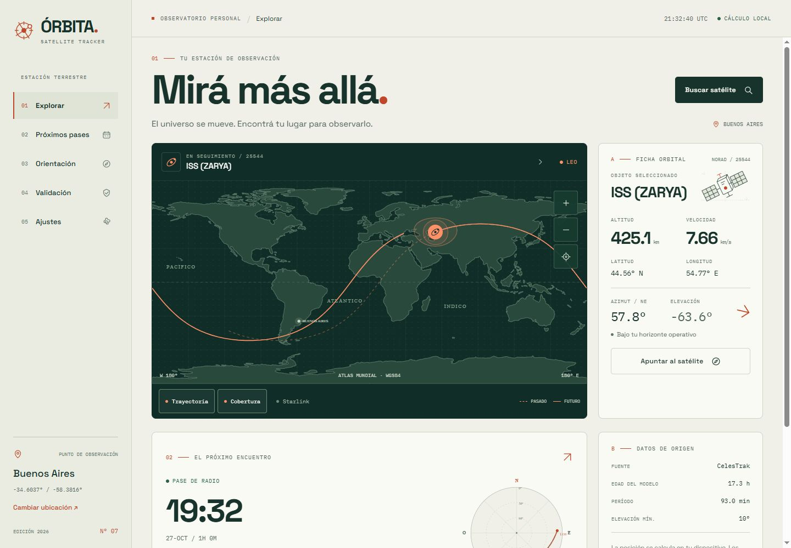

# Satellite Tracker · TP7

Aplicación **React Native + Expo + TypeScript** para seguir satélites reales, calcular posiciones SGP4/SDP4 en el dispositivo, predecir pases y preparar observaciones. Incluye proxy Node para custodiar credenciales, atlas offline y versión web para revisar la interfaz.

La interfaz **ÓRBITA** utiliza una estética de atlas científico: marfil, verde tinta y terracota, con Space Grotesk e IBM Plex Mono empaquetadas localmente. La agenda usa fichas horizontales en celular y una lista junto al sky chart en escritorio; todos los cálculos y proveedores se mantienen compartidos entre plataformas.



## Ejecutar

Requisitos: Node.js 22 o 24 y npm. Las versiones exactas están fijadas en `package-lock.json`.

```powershell
npm ci
npm run dev
```

Abrir **http://localhost:8081**. El proxy usa **http://localhost:3001**. Ambos procesos quedan en la terminal; Ctrl+C los detiene. También pueden iniciarse por separado con `npm run server` y `npm start`.

### Teléfono con Expo Go / Metro

1. Copiar `.env.example` a `.env`.
2. Cambiar `EXPO_PUBLIC_API_URL` por `http://IP_LOCAL_DE_TU_PC:3001`. La PC y el teléfono deben compartir red y el firewall debe permitir ese puerto en la red privada.
3. Ejecutar `npm run server` en una terminal y `npm start` en otra.
4. Escanear el QR con un cliente compatible con **Expo SDK 58**. Si Expo Go instalado corresponde a otro SDK, crear el build de desarrollo indicado abajo.

`npm start` elige Expo Go explícitamente. Para un cliente de desarrollo ya instalado, usar `npm run start:dev-client`.

El atlas vectorial, el motor SGP4 y las predicciones funcionan con datos guardados sin Internet. Google/Apple Maps se abren desde el botón bajo el mapa nativo; el atlas es la opción inicial y no requiere API key ni tiles. Las notificaciones locales y sensores se prueban en un dispositivo físico. Las tareas en segundo plano tienen restricciones del sistema y deben probarse en un build de desarrollo o de distribución.

### APK y build nativo

```powershell
# Requiere Android Studio, SDK Android y JDK configurados:
npm run android

# Alternativa remota: requiere cuenta Expo/EAS y una sesión iniciada:
npx eas-cli build --platform android --profile preview

# Cliente de desarrollo:
npx eas-cli build --platform android --profile development
```

El perfil `preview` produce un APK. iOS se construye en macOS/Xcode o EAS con credenciales Apple. No se incluye un APK fabricado: el entregable ejecutable disponible es el proyecto Metro. Si se usa Google Maps fuera de Expo Go, configurar `GOOGLE_MAPS_API_KEY` restringida al package/SHA del build; el atlas sigue disponible sin ella.

## Credenciales y APIs

El funcionamiento público usa **CelesTrak** y **Where the ISS at?**. Para completar las fuentes autenticadas, colocar únicamente en el `.env` del servidor:

```dotenv
N2YO_API_KEY=tu_clave
SPACETRACK_IDENTITY=tu_cuenta
SPACETRACK_PASSWORD=tu_password
```

Estas variables **no** llevan prefijo `EXPO_PUBLIC_`. El servidor no las devuelve en `/health`, en errores ni en el bundle. `.env` y cookies de sesión no se versionan. El proxy está destinado a desarrollo en una red local; para exponerlo en Internet se requiere HTTPS, autenticación de clientes y límites compartidos por instancia. `CORS_ORIGINS` configura los orígenes web admitidos. En producción móvil, el endpoint del proxy debe usar HTTPS.

## Uso

- **Explorar**: buscar por nombre/NORAD, filtrar estaciones/Starlink/GPS/meteorológicos/GEO, seguir posición, trayectoria y cobertura; acercar y centrar el atlas; activar hasta 80 Starlink.
- **Pases**: agenda de 24/48/72 h, AOS/TCA/LOS, azimut, duración, gráfico polar, filtro óptico y recordatorios configurables.
- **Orientación**: rumbo verdadero o magnético, giro relativo e inclinación del equipo; estado explícito cuando no hay sensores.
- **Validación**: comparar SGP4 con Where the ISS at? o N2YO en el timestamp de referencia; historial persistente y exportación CSV.
- **Ajustes**: GPS o coordenadas manuales, máscara de horizonte, anticipación, segundo plano, prueba de aviso y cancelación de recordatorios.

## Verificar

```powershell
npm run check          # TypeScript y pruebas del motor/proveedores
npm run export:web     # Compilación de producción web
npm run validate       # Medición real contra fuentes externas; requiere red
npx expo install --check
```

Las pruebas no consultan APIs: usan el snapshot real y el vector publicado de Vallado. `npm run validate` sí obtiene elementos y referencias actuales y escribe el informe, CSV y JSON crudo en `docs/`. N2YO solo se mide si existe su API key. Ninguna medición ausente se sustituye con valores inventados.

## Entregables y documentación

- [Modelo, arquitectura y limitaciones](docs/TECNICO.md)
- [Fuentes, caché, límites y fallback](docs/FUENTES.md)
- [Informe de validación real](docs/VALIDACION.md)
- [Trazabilidad RF-01 a RF-16 y entregables](docs/REQUISITOS.md)
- [Verificación nativa y guion de demostración](docs/DEMO.md)
- [Resultados de pruebas](docs/PRUEBAS.md)

Estructura: `src/core` matemática; `src/data` proveedores y repositorio; `src/services` sistema, ajustes y validación; `src/hooks` coordinación; `src/ui` mapas, SVG y componentes; `src/screens` pantallas; `server` proxy; `tests` pruebas; `assets` atlas y snapshot real.
